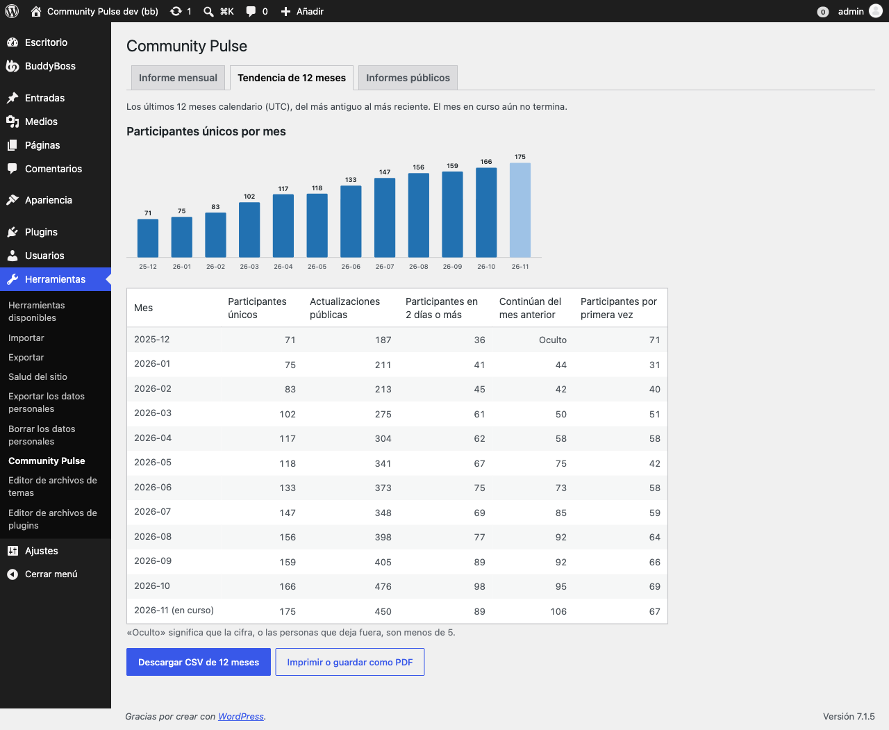
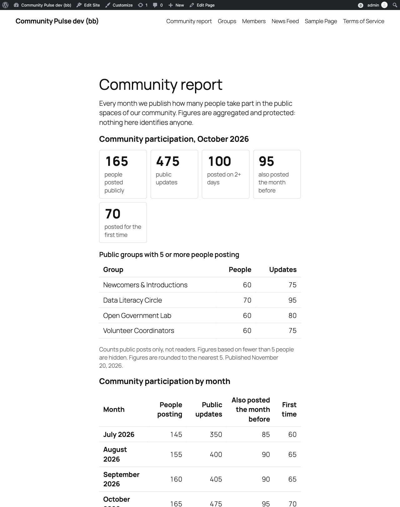

# Community Pulse para BuddyBoss

**Analítica de participación para comunidades en BuddyBoss Platform o BuddyPress, con la privacidad por delante.** Muestra cuántas personas participan cada mes, si vuelven y cuántas son nuevas. Las cifras protegidas se pueden publicar en tu sitio sin exponer a nadie.

Hay documentación más detallada en inglés: [guía de uso](docs/user-guide.md), [modelo de privacidad](docs/privacy-model.md) y [guía para desarrolladores](docs/developer.md).

## Qué hace

Todo se calcula **solo con datos agregados**, nunca por persona.

En **Herramientas → Community Pulse** hay tres pestañas:

1. **Informe mensual**, con estos indicadores:

   | Indicador | Pregunta que responde |
   |---|---|
   | Participantes únicos | ¿Cuántas personas publicaron algo público? |
   | Actualizaciones públicas | ¿Cuánto se publicó? |
   | Participantes en 2 días o más | ¿Cuántas personas volvieron a publicar otro día del mes? |
   | Continúan del mes anterior | ¿Cuántas personas publicaron este mes y también el anterior? |
   | Participantes por primera vez | ¿Cuántas personas publicaron por primera vez en la comunidad? |

   También muestra los grupos públicos con 5 participantes o más, un CSV y una vista para imprimir o guardar como PDF.

2. **Tendencia de 12 meses:** gráfico y tabla para ver si la participación crece y si las personas nuevas se quedan. Se descarga en CSV.

3. **Informes públicos:** publicas un mes terminado y lo muestras en cualquier página con `[community_pulse]`. Sirve para una página de transparencia, un informe anual o un reporte a donantes.

## Cómo protege la privacidad

- **Umbral de 5 personas.** Toda cifra describe al menos a 5 personas. Si en el mes publicaron menos, se oculta el mes entero.
- **Restas protegidas.** También se oculta una cifra cuando las personas que deja fuera son menos de 5. Por ejemplo, "18 de 20 publicaron en 2 días" revelaría a las 2 que publicaron un solo día.
- **Continuidad protegida en los dos meses.** La cifra de "continúan del mes anterior" se oculta si revela a pocas personas que dejaron de publicar.
- **Informes públicos congelados.** Los visitantes nunca consultan datos en vivo. Solo se publican meses terminados, y las cifras no cambian aunque alguien borre sus publicaciones después.
- **Redondeo a 5 al publicar.** Viene activado por defecto y dificulta deducir cifras pequeñas restando unas de otras.
- **Sin envíos.** Nada se manda a servicios externos, y nunca se leen textos, nombres, correos, mensajes ni IP.

El umbral **reduce la exposición, pero no garantiza el anonimato**. Quien administra puede conocer a quienes publican. Los riesgos que quedan están descritos en el [modelo de privacidad](docs/privacy-model.md).

## Requisitos e instalación

1. WordPress 6.6 o superior y PHP 8.1 o superior, con BuddyBoss Platform o BuddyPress y los componentes **Actividad** y **Grupos** activos. Está probado con BuddyBoss Platform 3.8.0 y BuddyPress 14.5.6 ([VALIDATION.md](VALIDATION.md)).
2. Descarga `buddyboss-community-pulse-<versión>.zip` desde [Releases](https://github.com/alex-roc/buddyboss-community-pulse/releases).
3. Entra a **Plugins → Añadir nuevo plugin → Subir plugin**, sube el ZIP y pulsa **Activar**.
4. Abre **Herramientas → Community Pulse**.

Si el sitio o tu perfil están en cualquier variante de español (`es_ES`, `es_MX`, `es_AR`, `es_BO`…), las pantallas aparecen en español. Al borrar el plugin se elimina lo único que guarda: los informes publicados.

## Publicar un informe

1. En **Informes públicos**, elige un mes terminado. Deja marcado **Redondear a múltiplos de 5** y decide si quieres **Incluir grupos públicos**.
2. Pulsa **Publicar**.
3. En una página, añade un bloque *Shortcode* con una de estas opciones:

| Shortcode | Muestra |
|---|---|
| `[community_pulse]` | El último mes publicado |
| `[community_pulse month="2026-10"]` | Un mes publicado concreto |
| `[community_pulse view="history"]` | Una tabla con todos los meses publicados |
| `[community_pulse groups="no"]` | Oculta la tabla de grupos |

**Actualizar** vuelve a publicar el mes con los datos actuales. **Retirar** lo quita de todas las páginas a la vez.

## Cómo leer las cifras

- **Mes en curso:** sus cifras son parciales. Compara solo meses terminados.
- **"Oculto" no es cero:** la cifra es demasiado pequeña para mostrarla con seguridad.
- **Por primera vez** cuenta la primera publicación pública de una persona, aunque se haya registrado hace tiempo.
- **Continúan + primera vez no da el total:** algunas personas vuelven tras una pausa de dos meses o más.
- **Grupos:** una persona que publica en tres grupos cuenta en los tres, así que no sumes las filas.

## Configuración

| Filtro | Valor por defecto | Para qué |
|---|---|---|
| `community_pulse_capability` | `manage_options` | Quién puede ver los informes y descargar los CSV |
| `community_pulse_publish_capability` | `manage_options` | Quién puede publicar o retirar informes públicos |
| `community_pulse_threshold` | `5` | Tamaño mínimo de cualquier cifra. Se puede subir, nunca bajar de 5 |

## Problemas frecuentes

| Mensaje | Qué hacer |
|---|---|
| "Activa BuddyBoss Platform o BuddyPress con los componentes Actividad y Grupos." | Actívalos en **BuddyBoss → Ajustes → Componentes** o en **Ajustes → BuddyPress → Componentes** |
| "Resumen oculto: menos de 5 personas…" | Es lo esperado en meses o comunidades pequeñas |
| "No se pudo publicar el informe." | Solo se pueden publicar meses terminados (según la hora UTC) |
| El shortcode no muestra nada | No hay un mes publicado, o el `month` indicado no está publicado |
| No aparece el menú | Tu usuario no tiene el permiso necesario |

## Licencia

GPL-2.0-or-later. © 2026 Alex Ojeda Copa.
