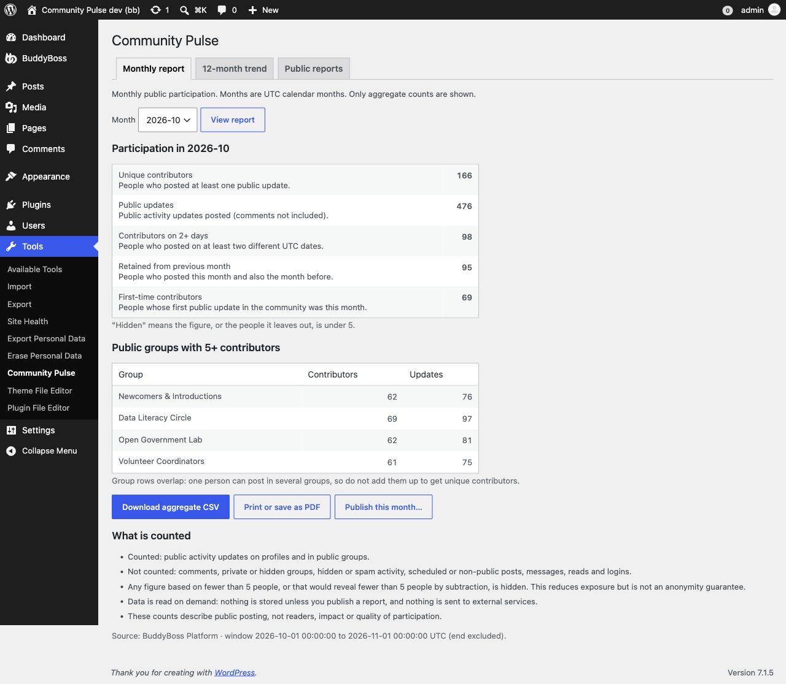
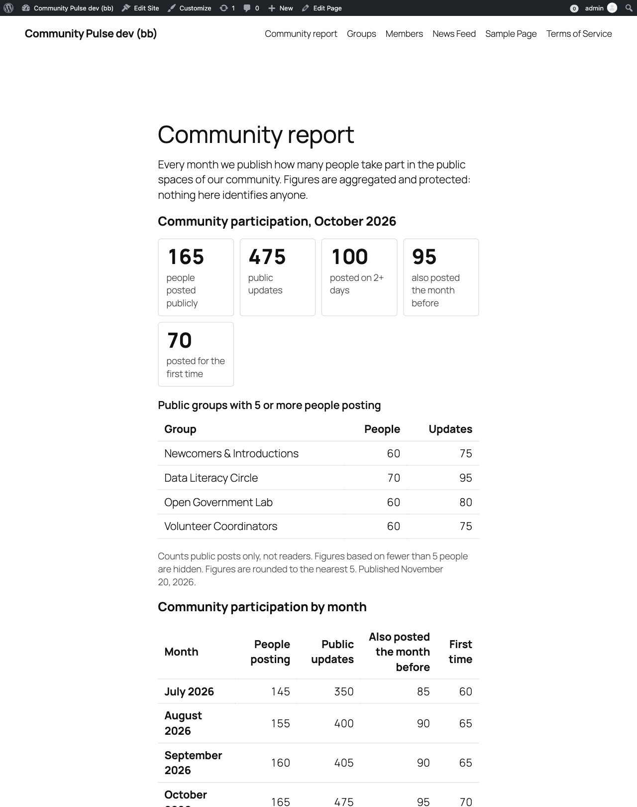
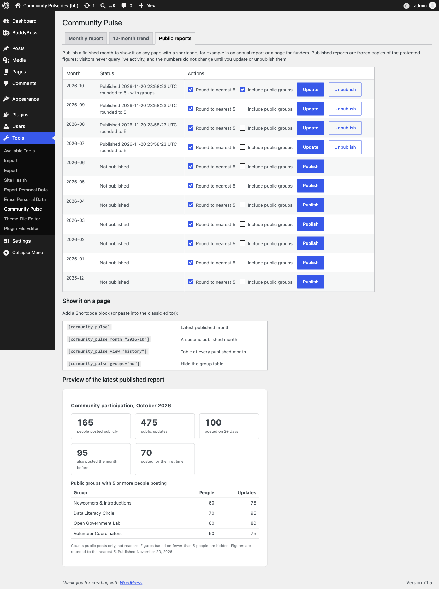
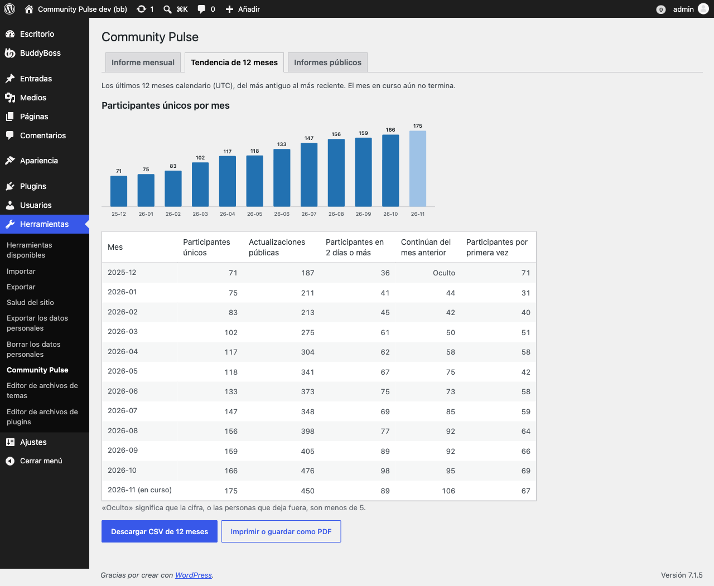

# Community Pulse for BuddyBoss

**Privacy-first participation analytics for BuddyBoss Platform and BuddyPress communities.** See how many people take part each month, whether they come back, and how many are new, then publish protected figures on your site without exposing anyone.

[Leer en español](README.es.md) · [User guide](docs/user-guide.md) · [Privacy model](docs/privacy-model.md) · [Developer guide](docs/developer.md)


**Status: 0.3.0, early release.** It is integration-tested on BuddyBoss Platform 3.8.0 and BuddyPress 14.5.6 (see [VALIDATION.md](VALIDATION.md)). Try it on a staging copy first. Created in November 2026 by Alex Ojeda Copa. It is not affiliated with BuddyBoss or BuddyPress.

## Why another analytics plugin?

Most community analytics track individuals: who logged in, who posted most, leaderboards of members. Community Pulse answers the questions community managers, boards and funders actually ask, using **aggregates only**:

- **Monthly report:** unique contributors, public updates, contributors on 2+ days, people **retained** from the previous month, **first-time** contributors, and public groups with real conversation.
- **12-month trend:** an accessible chart and table to see growth, retention and newcomers over time.
- **Public reports:** publish a finished month as a frozen, rounded snapshot and show it on any page with `[community_pulse]`. It works for transparency pages, annual reports and funder updates.
- **Exports:** CSV files that open with accents intact and are safe from formula injection, plus a print view to save as PDF.

Privacy is built in rather than added later:

- every figure describes at least 5 people;
- sub-counts whose complement is small are hidden too;
- public pages never touch live data;
- only finished months can be published;
- nothing is sent anywhere.

See the [privacy model](docs/privacy-model.md) for what this protects against and what it does not.

| Monthly report | Public page |
|---|---|
|  |  |
| **Publishing** | **In Spanish** |
|  |  |

## Requirements

- WordPress 6.6 or newer and PHP 8.1 or newer.
- **BuddyBoss Platform**, or **BuddyPress**, with the **Activity** and **Groups** components enabled.
- No BuddyBoss Pro, theme, API key, SaaS account, build step or extra database tables.

## Installation

1. Download `buddyboss-community-pulse-<version>.zip` from the [latest release](https://github.com/alex-roc/buddyboss-community-pulse/releases).
2. In WordPress go to **Plugins → Add New Plugin → Upload Plugin**, choose the ZIP, then **Activate**.
3. Open **Tools → Community Pulse**, or use the **View report** link in the plugins list.

To update, upload the newer ZIP and confirm **Replace current with uploaded**. Deleting the plugin removes its only stored data, the published snapshots.

## Quick start

1. **Tools → Community Pulse → Monthly report:** pick last month and read the figures. "Hidden" means fewer than 5 people were involved.
2. **12-month trend:** check whether participation is growing and whether newcomers stay.
3. **Public reports:** publish last month (rounded, without groups), then add `[community_pulse]` to a page.

Details for every screen, indicator and CSV column are in the [user guide](docs/user-guide.md).

## Configuration

| Filter | Default | Use |
|---|---|---|
| `community_pulse_capability` | `manage_options` | Who can view reports and download CSV files |
| `community_pulse_publish_capability` | `manage_options` | Who can publish or unpublish public reports |
| `community_pulse_threshold` | `5` | Minimum group size for any figure. It can be raised, never lowered below 5 |

```php
add_filter('community_pulse_threshold', fn() => 10);
```

The interface is in English and Spanish. Spanish is used for any `es_*` locale.

## Development

```sh
scripts/dev-env.sh up && scripts/dev-env.sh test   # disposable WordPress + BuddyBoss + BuddyPress
php tests/unit.php                                  # unit tests only, no WordPress needed
python3 scripts/package.py dist                     # build the installable ZIP
```

See the [developer guide](docs/developer.md) for the architecture, queries, hooks, tests, translations and releases. [CHANGELOG.md](CHANGELOG.md) has the release notes.

## License

GPL-2.0-or-later. Copyright 2026 Alex Ojeda Copa. No warranty. Validate on staging before deploying.
