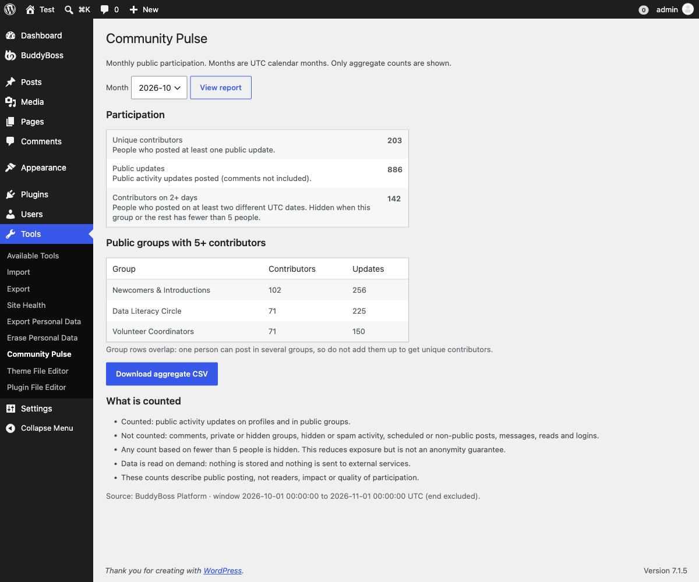

# Community Pulse for BuddyBoss

A small WordPress plugin for community managers who need a **monthly view of public participation** in a BuddyBoss Platform or BuddyPress community, without exporting member profiles, post content or any per-person data.

**Status: 0.2.0, early release.** It is integration-tested on BuddyBoss Platform 3.8.0 and BuddyPress 14.5.6 (see [VALIDATION.md](VALIDATION.md)). Try it on a staging copy first. Created in November 2026 by Alex Ojeda Copa. It is not affiliated with BuddyBoss or BuddyPress.

[Leer en español](README.es.md)



## What it answers

Under **Tools → Community Pulse**, an administrator picks one of the last 12 calendar months (UTC) and sees:

| Indicator | Question it answers |
|---|---|
| Unique contributors | How many people posted publicly this month? |
| Public updates | How much public posting happened? |
| Contributors on 2+ days | How many people came back to post on more than one day? |
| Public groups with 5+ contributors | Which public groups have a real conversation going? |

The same numbers download as an **aggregate CSV** for reports to a board, funders or the team.

These are indicators of **public posting**. They are not readers or "active users", social impact, causality, or quality of participation.

## Requirements

- WordPress 6.6 or newer and PHP 8.1 or newer.
- **BuddyBoss Platform**, or **BuddyPress**, with the **Activity** and **Groups** components enabled.
- No BuddyBoss Pro, theme, API key, SaaS account, build step or extra database tables.

## Installation

1. Download `buddyboss-community-pulse-<version>.zip` from the [latest release](https://github.com/alex-roc/buddyboss-community-pulse/releases).
2. In WordPress go to **Plugins → Add New Plugin → Upload Plugin**, choose the ZIP, then **Activate**.
3. Open **Tools → Community Pulse**, or use the **View report** link in the plugins list.

To update, upload the newer ZIP the same way and confirm **Replace current with uploaded**. To uninstall, deactivate and delete it. The plugin stores no data or options, so nothing is left behind.

## Using the report

1. Choose a month and press **View report**. The current month is flagged as **in progress** because its counts keep growing.
2. Read the **Participation** table. A value shows as **Hidden** when it would describe fewer than 5 people (see [Privacy](#privacy-and-security)).
3. Read the **groups** table. A person who posts in three groups counts once in each, so **do not add up group rows** to get unique contributors.
4. Press **Download aggregate CSV** to keep a monthly record. Spreadsheets open it with accents intact.

Typical uses include checking whether participation holds after a campaign or onboarding cohort, seeing which public groups need facilitation, and reporting a monthly participation figure without sharing personal data.

### CSV columns

| Column | Meaning |
|---|---|
| `month_utc` | Month reported, `YYYY-MM` |
| `partial_month` | `yes` if the month had not ended when exported |
| `scope` | `overall`, `group`, or `note` |
| `group_name` | Public group name (empty for `overall`). It is formula-escaped, so a leading `'` may appear |
| `contributors` | Distinct people who posted, or `suppressed` |
| `public_updates` | Number of eligible updates, or `suppressed` |
| `contributors_2plus_days` | Overall only. A number, `suppressed`, or `not_calculated` for groups |

## Definitions

| Term | Definition |
|---|---|
| Contribution | One eligible `activity_update`. Comments, registrations, group joins and other activity types are not counted |
| Eligible | Not spam, not hidden (`hide_sitewide = 0`), by a real user, on a profile or in a **public** group. On BuddyBoss it must also be `privacy = public` and `status = published` |
| Contributor | Distinct user with at least one eligible contribution in the month |
| Contributor on 2+ days | Eligible contributions on at least two different UTC calendar dates |
| Group row | Public group with at least 5 distinct contributors that month. At most 100 rows are shown, and a note marks truncation |

Months are fixed UTC calendar months, and the platform stores activity dates in UTC. Comments are excluded because their visibility depends on the parent post.

## Privacy and security

- Only users with `manage_options` can view or export. The CSV link also carries a WordPress nonce.
- All aggregation happens in SQL. User IDs never reach PHP, and names, emails, profile fields, post text, messages and IPs are never read or exported. Only public group names are shown.
- **Small-cell suppression:** if fewer than 5 people contributed, the whole summary is hidden. The 2+ days count is hidden when it, or the rest of the contributors, is under 5, which also hides its complement. Groups under 5 contributors are omitted.
- Private and hidden groups, hidden activity, spam, deleted or anonymous users, scheduled and non-public posts are excluded.
- Nothing is stored. No cron job runs, no tables or options are created, and nothing is sent to external services.
- The CSV escapes cells that a spreadsheet could run as formulas (`= + - @`, tab, carriage return).
- **Thresholds reduce exposure. They do not guarantee anonymity.** An administrator may already know who posts, and comparing months can reveal changes. Share exports under your organisation's data policy.
- There is no login or read tracking, no registered-user denominator, no demographics and no individual rankings. Those need a separate, consent-aware design.

## Configuration

**Who can see the report.** By default only administrators (`manage_options`) can. To allow another role, grant it a capability and filter it, for example in a small must-use plugin:

```php
add_filter('community_pulse_capability', fn() => 'moderate_comments');
```

Use a capability that only trusted staff have, because the report and CSV are available to whoever holds it.

**Language.** The interface is in English, with a bundled Spanish translation. Any Spanish site locale (`es_ES`, `es_MX`, `es_AR`, …) uses it. Other languages can be added with the template in `languages/community-pulse.pot`.

## Performance

Reports are computed on demand with two aggregate queries over the activity table, using its existing `date_recorded` index. On a synthetic table of 600,000 activity rows (20,000 users, 300 groups), one month took about 0.75 s on a laptop with MariaDB 11.4. On very large communities, test on staging first.

## Troubleshooting

| Message | Fix |
|---|---|
| "Activate BuddyBoss Platform or BuddyPress with the Activity and Groups components." | Enable both components under **BuddyBoss → Settings → Components** or **Settings → BuddyPress → Components** |
| "Summary hidden: fewer than 5 people posted public updates this month." | Expected for small or quiet communities. Pick another month |
| The groups table is empty | No public group reached 5 contributors that month. Private and hidden groups are never listed |
| "Could not read community activity." | The platform's database schema differs from what is expected. Update the platform and report the version in an issue |
| The menu is missing | Your user lacks the required capability (see [Configuration](#configuration)) |

## Development

```sh
php tests/unit.php                       # no WordPress needed
python3 scripts/package.py dist          # builds dist/buddyboss-community-pulse-<version>.zip
# Disposable WordPress database only, with the plugin active:
wp eval-file /absolute/path/to/buddyboss-community-pulse/tests/integration.php
```

The integration test creates synthetic users, groups and posts through the platform APIs, including the real posting functions `bp_activity_post_update` and `groups_post_update`, and deletes them in `finally`. **Never run it on a production site.** It assumes no other activity exists in the current month.

For a disposable local stack, copy the steps in `.github/workflows/test.yml`. Two gotchas:
- On macOS, a MariaDB Unix socket path must stay under 104 characters.
- On a fresh BuddyBoss install, the first wp-admin visit can reset `bp-active-components` and switch Groups off. If the report then asks you to activate the platform, re-enable Groups.

GitHub Actions runs syntax and unit checks on PHP 8.1, 8.3 and 8.4. It also runs the integration test on WordPress with MariaDB for BuddyBoss Platform 3.8.0 and for current BuddyPress, installing the **packaged ZIP** rather than the source tree.

To update translations after changing strings, use `wp i18n make-pot . languages/community-pulse.pot --domain=community-pulse --exclude=tests,scripts`. Then update `languages/community-pulse-es_ES.po` and run `wp i18n make-mo languages/community-pulse-es_ES.po languages` and `wp i18n make-php languages/community-pulse-es_ES.po languages`.

### Architecture

- `community-pulse.php`: plugin header and bootstrap.
- `includes/class-report.php`: month window, the two SQL aggregates, suppression rules, label normalisation and CSV escaping. It has no output.
- `includes/class-plugin.php`: admin screen, capability, CSV export and translations.

Table names come from the platform (`buddypress()->activity->table_name`) and are validated. Every varying value goes through `$wpdb->prepare`. Group names are normalised the way the platform displays them, with slashes and HTML entities removed.

References: [BuddyBoss Platform source](https://github.com/buddyboss/buddyboss-platform) (`bp-activity/classes/class-bp-activity-activity.php`), [`current_user_can`](https://developer.wordpress.org/reference/functions/current_user_can/), [nonces](https://developer.wordpress.org/apis/security/nonces/), [`wpdb::prepare`](https://developer.wordpress.org/reference/classes/wpdb/prepare/), [OWASP CSV injection](https://owasp.org/www-community/attacks/CSV_Injection).

## Roadmap

Ideas, not commitments: a 12-month trend view, aggregate retention and new-contributor share, a configurable threshold that never goes below 5, and accessible charts.

See [CHANGELOG.md](CHANGELOG.md) for release notes.

## License

GPL-2.0-or-later. Copyright 2026 Alex Ojeda Copa. No warranty. Validate on staging before deploying.
