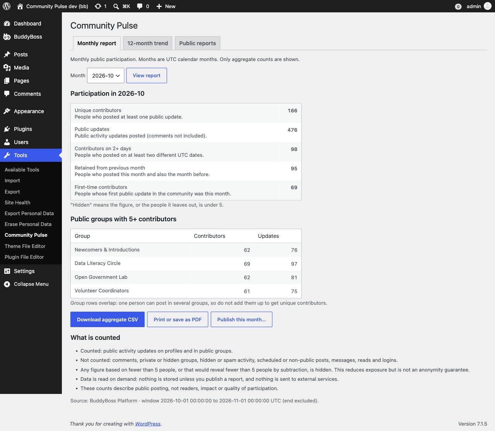
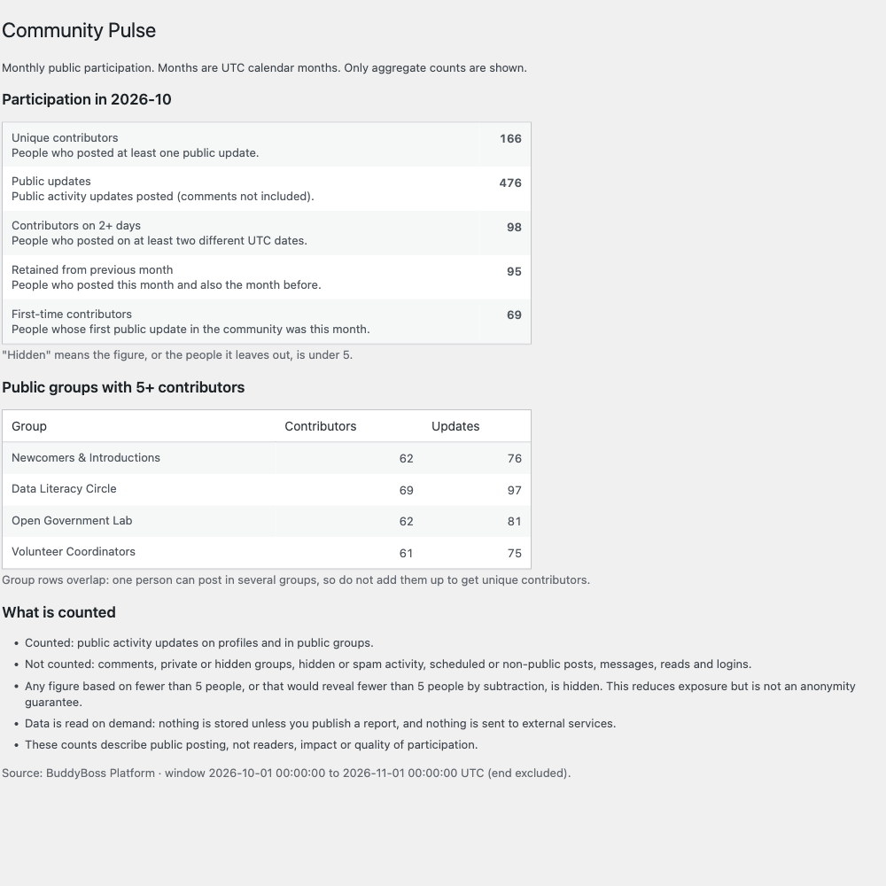
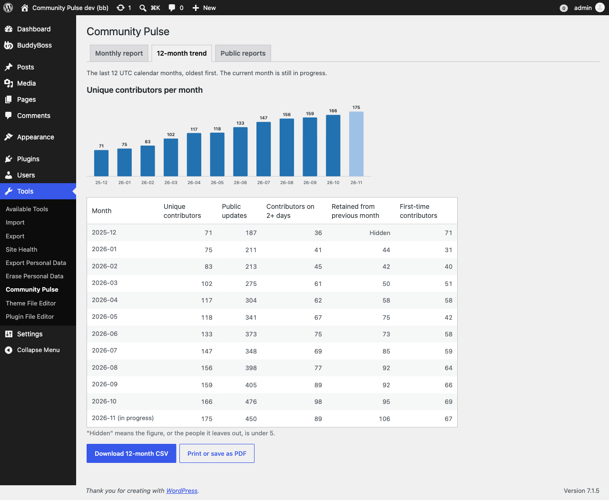
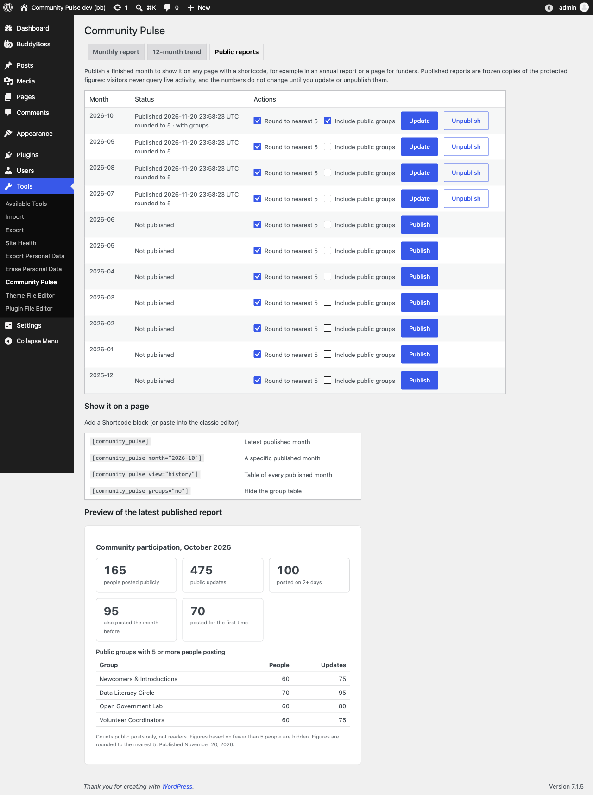
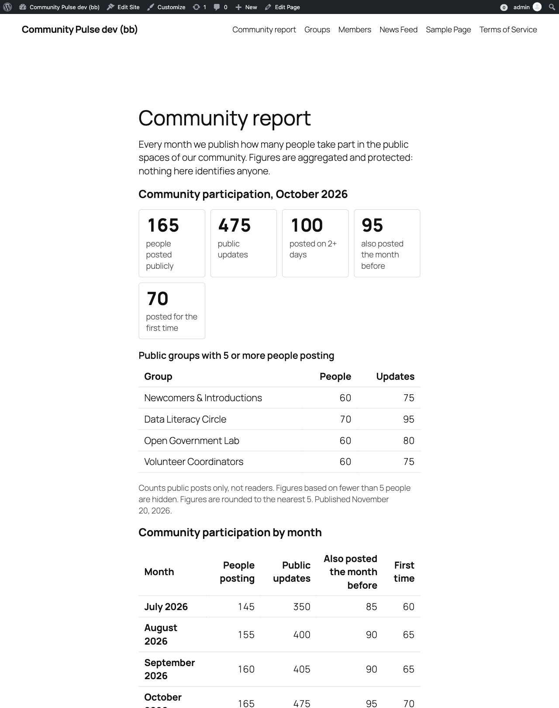
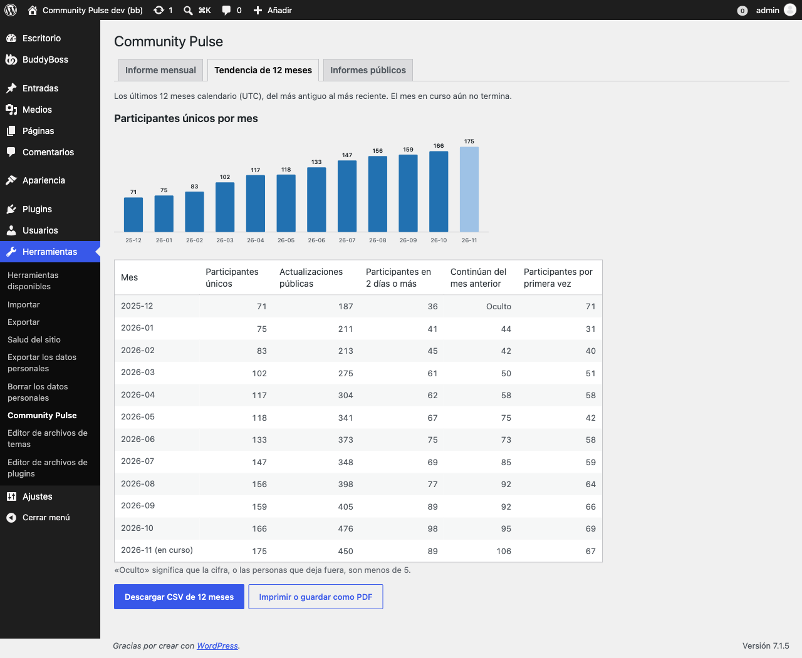

# User guide

This guide is for community managers who read and share participation figures with Community Pulse. For installation, see the [README](../README.md). For how figures are protected, see the [privacy model](privacy-model.md).

Everything lives under **Tools → Community Pulse**, in three tabs.

## 1. Monthly report

Pick a month (the current UTC month or one of the 11 before it) and press **View report**.

| Indicator | Meaning | Hidden when |
|---|---|---|
| Unique contributors | People who posted at least one public update | Fewer than 5 people posted (the whole month is hidden) |
| Public updates | Number of eligible public updates | The month is hidden |
| Contributors on 2+ days | People who posted on at least two different UTC dates | It, or the people who posted on only one day, is under 5 |
| Retained from previous month | People who posted this month **and** the month before | It is under 5, or one of these groups is under 5: this month's contributors who did not post last month, or last month's contributors who stopped. Also hidden when last month had fewer than 5 contributors |
| First-time contributors | People whose first ever public update in the community was this month | It, or the people who had posted before, is under 5 |

Below the summary, **public groups with 5+ contributors** lists each public group with enough people posting. One person can post in several groups, so do not add the rows up.

Actions:

- **Download aggregate CSV**: the same figures as a spreadsheet (see [CSV files](#csv-files)).
- **Print or save as PDF**: opens the browser's print dialog. The admin menu and buttons are hidden in print, so you get a clean one-page report. Choose "Save as PDF" as the printer.
- **Publish this month…**: goes to the Public reports tab. It is only shown for finished months.

### Reading the numbers

- **The current month is partial.** Its figures keep growing until the month ends (UTC). Compare finished months only.
- **"Hidden" is not zero.** It means the figure is too small to show safely, or would reveal a small group by subtraction.
- **First-time contributors** includes people who joined long ago but never posted publicly before. It measures first participation, not new sign-ups.
- **Retained + first-time is not the total.** Some contributors come back after a pause of two months or more. They are neither "retained from the previous month" nor "first-time".

## 2. 12-month trend

The bar chart shows unique contributors for the last 12 months. The current month is lighter because it is still in progress. The table below it has every indicator for every month, with the same suppression rules. **Download 12-month CSV** exports the table.

Typical questions it answers:

- Is participation growing, stable or falling?
- After a campaign, onboarding cohort or event, did more people start posting (first-time), and did they come back the next month (retained)?
- Does activity concentrate in a few people (updates rising while contributors stay flat)?

## 3. Public reports

Use this tab to share figures outside the admin, for example on a transparency page, in an annual report or in an update for funders.

1. Choose a **finished** month.
2. Decide on the options:
   - **Round to nearest 5** (on by default): published figures are rounded, which makes small differences between numbers harder to exploit.
   - **Include public groups** (off by default): adds the group table.
3. Press **Publish**. The plugin stores a frozen copy of that month's protected figures.
4. Add the shortcode to any page or post, in a *Shortcode* block or the classic editor.

| Shortcode | Shows |
|---|---|
| `[community_pulse]` | The latest published month |
| `[community_pulse month="2026-10"]` | A specific published month |
| `[community_pulse view="history"]` | A table with every published month |
| `[community_pulse groups="no"]` | Hides the group table even if it was published |
| `[community_pulse title="Our community in October"]` | Uses your own heading |

Published figures **do not change** when new activity arrives. To refresh them, press **Update**, which re-publishes with the current data. **Unpublish** removes the month from every public page at once. If nothing is published, the shortcode shows nothing to visitors and a short hint to people who can publish.

The public block uses your theme's fonts and colours. It prints well too, so visitors can save the page as a PDF.

## CSV files

Both files are UTF-8 with a byte-order mark, so Excel, LibreOffice and Google Sheets keep accents.

**Monthly CSV** (`community-pulse-YYYY-MM.csv`):

| Column | Meaning |
|---|---|
| `month_utc` | Month, `YYYY-MM` |
| `partial_month` | `yes` if the month had not ended when exported |
| `scope` | `overall`, `group` or `note` |
| `group_name` | Public group name, empty for `overall`. A leading `'` means the name looked like a formula and was escaped |
| `contributors` | Distinct people, or `suppressed` |
| `public_updates` | Updates, or `suppressed` |
| `contributors_2plus_days` | Overall only. A number, `suppressed`, or `not_calculated` for groups |
| `retained_from_previous_month` | Overall only, as above |
| `first_time_contributors` | Overall only, as above |

**12-month CSV** (`community-pulse-12-months-YYYY-MM.csv`) has one overall row per month, with the columns `month_utc`, `partial_month`, `contributors`, `public_updates`, `contributors_2plus_days`, `retained_from_previous_month` and `first_time_contributors`.

## Language

The screens appear in Spanish when the site or your user profile uses any Spanish locale (`es_ES`, `es_MX`, `es_AR`, `es_BO`…), and in English otherwise.

## Troubleshooting

| You see | What to do |
|---|---|
| "Activate BuddyBoss Platform or BuddyPress with the Activity and Groups components." | Enable both under **BuddyBoss → Settings → Components** or **Settings → BuddyPress → Components** |
| "Summary hidden: fewer than 5 people…" | Expected for small or quiet months |
| Retained is "Hidden" for the oldest month | The month before it had fewer than 5 contributors, or is outside the data. This is expected |
| The groups table is empty | No public group reached 5 contributors. Private and hidden groups are never listed |
| "The report could not be published." | Only finished months can be published. Wait until the month ends (UTC) |
| The shortcode shows nothing | No month is published, or the `month` you gave is not published. Log in as an administrator to see a hint |
| The menu is missing | Your user lacks the capability (see [developer docs](developer.md#hooks)) |
